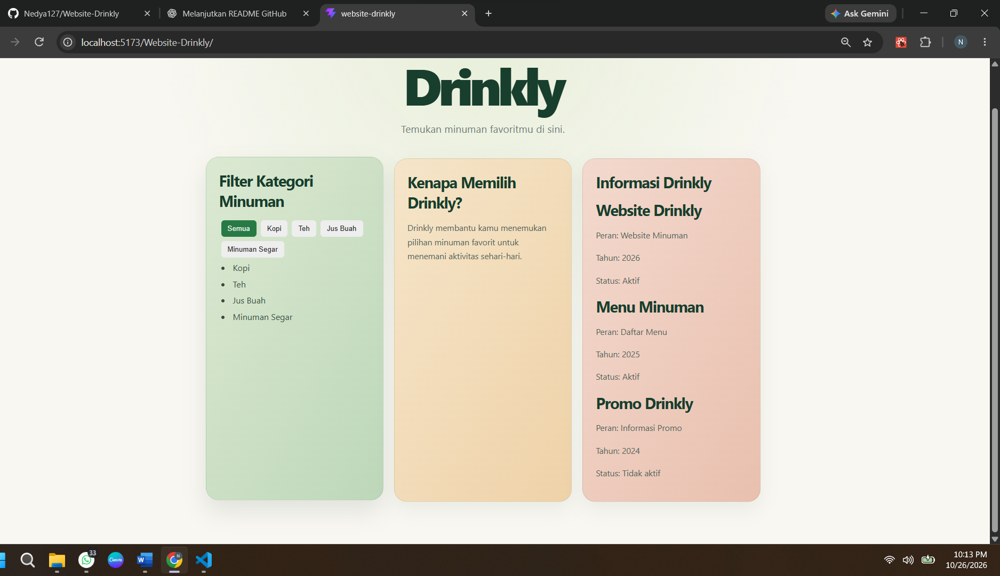

# Website Drinkly

Website Drinkly adalah proyek website minuman yang dibuat menggunakan React dan Vite. Website ini menampilkan daftar minuman, fitur filter kategori, dan informasi mengenai Website Drinkly.

## Teknologi

- React
- Vite
- JavaScript
- CSS

## Fitur Aplikasi

- Menampilkan daftar minuman.
- Memfilter minuman berdasarkan kategori.
- Menampilkan informasi tentang Website Drinkly.
- Menampilkan informasi nama, peran, tahun, dan status melalui komponen `WebsiteDrinkly`.

## Struktur Komponen

| File | Fungsi |
|---|---|
| `src/App.jsx` | Komponen utama aplikasi dan fitur filter kategori minuman. |
| `src/components/WebsiteDrinkly.jsx` | Komponen untuk menampilkan informasi nama, peran, tahun, dan status. |
| `src/main.jsx` | Titik masuk aplikasi React. |
| `src/index.css` | File untuk pengaturan gaya tampilan aplikasi. |

## Props Komponen WebsiteDrinkly

Komponen `WebsiteDrinkly` menerima empat props berikut:

| Props | Tipe Data | Fungsi |
|---|---|---|
| `nama` | String | Menampilkan nama informasi. |
| `peran` | String | Menampilkan peran atau jenis informasi. |
| `tahun` | Number | Menampilkan tahun. |
| `aktif` | Boolean | Menampilkan status Aktif atau Tidak aktif. |

Komponen `WebsiteDrinkly` digunakan tiga kali pada `App.jsx`, yaitu untuk menampilkan informasi Website Drinkly, Menu Minuman, dan Promo Drinkly.

## Fitur Filter Kategori

Fitur filter kategori dibuat menggunakan React `useState`.

Kategori yang tersedia adalah:

- Semua
- Kopi
- Teh
- Jus Buah
- Minuman Segar

Ketika pengguna memilih tombol kategori, daftar minuman akan menyesuaikan kategori yang dipilih.

## Screenshot Aplikasi



## Menjalankan Proyek

1. Clone repository GitHub:

   ```bash
   git clone https://github.com/Nedya127/Website-Drinkly.git
   ```

2. Masuk ke folder proyek:

   ```bash
   cd Website-Drinkly
   ```

3. Instal dependensi:

   ```bash
   npm install
   ```

4. Jalankan aplikasi:

   ```bash
   npm run dev
   ```

5. Buka alamat lokal yang muncul di terminal menggunakan browser.

## Penggunaan AI

AI digunakan sebagai bantuan untuk memahami kode React, menjelaskan fungsi komponen dan props, serta menyusun dokumentasi README. Penjelasan ini disesuaikan dengan bantuan AI yang digunakan selama pengerjaan proyek.
